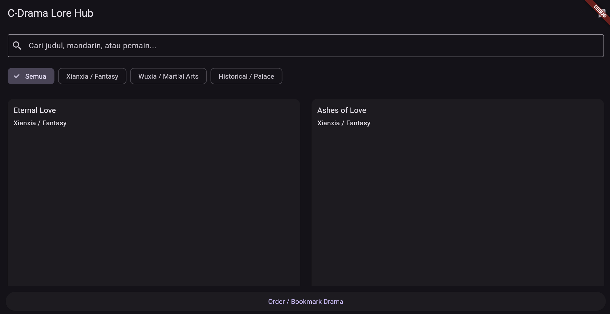
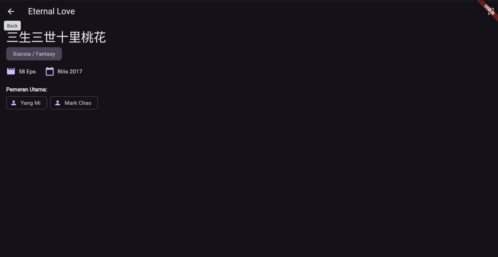
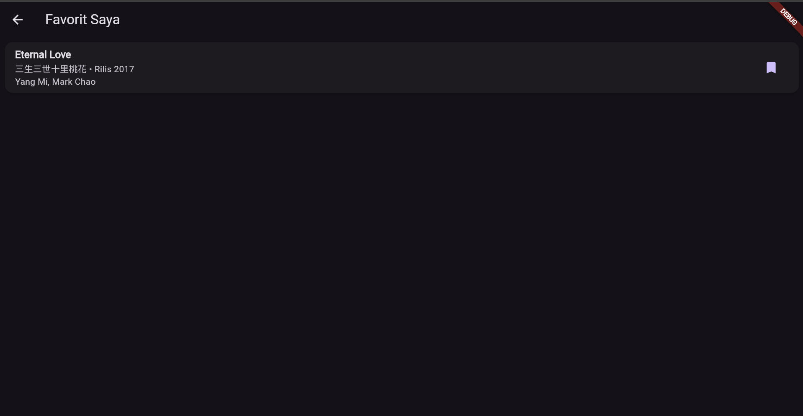

<<<<<<< HEAD
1. Track: Track B — The Lore & Discovery 
Hub.Deskripsi: Aplikasi katalog/direktori C-Drama yang terbagi ke dalam 3 sub-genre (Xianxia, Wuxia, dan Historical/Palace) untuk mengeksplorasi cerita, statistik episode, dan daftar pemeran utama.

2. Category Filtering: Filter drama berdasarkan genre dengan FilterChip.
   Real-time Search: Pencarian judul (Bahasa Inggris/Mandarin) dan nama pemain.
   Detail & Lore Screen: Informasi lengkap rilis, episode, genre, dan daftar pemain.
   Bookmark System: Menyimpan dan menghapus daftar drama favorit.
   Light/Dark Mode: Dukungan tema otomatis Material Design 3.
   Empty State: Tampilan khusus jika hasil pencarian tidak ditemukan.

3. Screenshots:
| Discovery Screen | Detail Screen | Bookmark Screen |
|  |  |  |

4. Release APK:
File APK rilis yang dapat diinstal langsung pada perangkat Android:
   https://github.com/Kevin351835/vispro_W4_Kevin/releases 

5. Setup Instructions:
   1. Clone repositori ini:
   git clone https://github.com/Kevin351835/vispro_W4_Kevin.git
   
   2. Masuk ke folder proyek:
   cd vispro_W4_Kevin
   
   3. Unduh dependensi:
   flutter pub get
   
   4. Jalankan analisis kode:
   flutter analyze
   
   5. Jalankan aplikasi:
   flutter run
=======
# homework_4

A new Flutter project.

## Getting Started

This project is a starting point for a Flutter application.

A few resources to get you started if this is your first Flutter project:

- [Learn Flutter](https://docs.flutter.dev/get-started/learn-flutter)
- [Write your first Flutter app](https://docs.flutter.dev/get-started/codelab)
- [Flutter learning resources](https://docs.flutter.dev/reference/learning-resources)

For help getting started with Flutter development, view the
[online documentation](https://docs.flutter.dev/), which offers tutorials,
samples, guidance on mobile development, and a full API reference.
>>>>>>> f6385ae7d363f022f66564ba3f51e50ed49e0dcc
